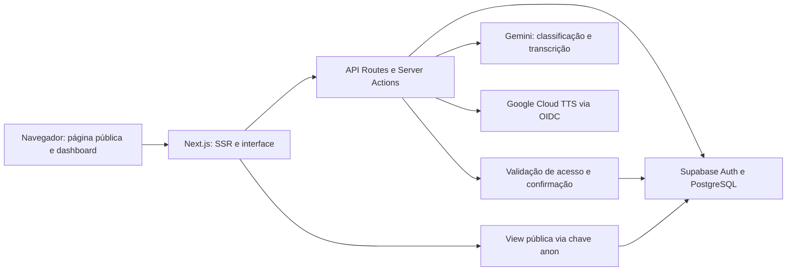
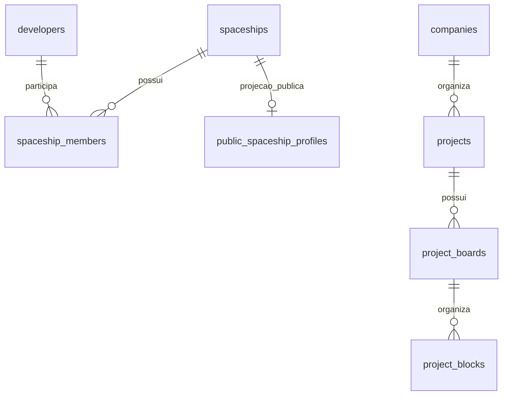

# Documentação técnica

Complementa o README com decisões e contratos para continuidade. Snapshot e autoria: [evidências](EVIDENCIAS.md). Limitações operacionais: [HANDOFF](../HANDOFF.md).

## Arquitetura e fronteiras

A navegação local usa aliases por perfil antes da classificação por IA. O contexto do usuário é construído no servidor; o modelo não é executor de SQL. O modal e o loop de voz coordenam gravação, transcrição e reprodução, com cancelamento e resposta escrita em falhas.

## APIs e ações
| Interface | Contrato e responsabilidade |
|---|---|
| `POST /api/orbitinho/voice-intent` | Classifica texto em intenção; autenticação, cota e alternativa local. Ver `src/lib/voice/orbitinhoAiService.ts` e handler para payload exato |
| `POST /api/ai/transcribe-orbitinho` | Recebe áudio, exige sessão e devolve texto; limites de tamanho no handler |
| `POST /api/orbitinho/tts` | Recebe texto e sintetiza áudio via Google Cloud; exige sessão |
| Server Actions `orbitinho-context.ts` | Contexto restrito à identidade autenticada |
| `orbitinho-move.ts` e `project-board.ts` | Preparam movimentação, validam acesso e executam após confirmação |
| `spaceships.ts` | Gestão da Espaçonave, publicação e operações relacionadas |
| `GET /spaceships/[slug]` | HTML público, metadados e 404 para perfil indisponível |

Server Actions não são uma API REST pública estável. Gemini e Google Cloud são integrações externas da frente Orbitinho; Supabase atende dados, identidade e Storage. Stripe, Asaas e Resend pertencem a outros fluxos da plataforma e não são requisito para uma demonstração somente de navegação local.

## Modelo de dados
Diagrama conceitual baseado nas consultas; não substitui DDL nem comprova constraints implantadas.

A leitura pública em `src/lib/publicSpaceship.ts` consulta `public_spaceship_profiles` com `slug` e `is_public=true`, valida por Zod e descarta campos fora do contrato. O DTO inclui nome, descrição, imagens, localização, especialidades, contagens, data e listas `portfolio`/`crew`. Portfólio: título, descrição, tecnologias, conclusão e nome do cliente; tripulação: nome, avatar, especialidade e nível. O contrato exige que consentimentos sejam resolvidos na camada de dados; uma lista recebida pelo frontend não comprova consentimento.

O repositório não contém um conjunto completo de migrations replayáveis. Confirmar schema, view, RLS e opt-ins no banco do cliente antes de promover o ambiente; não reconstruir produção por inferência desse diagrama.

## Autenticação e segurança
Sessão Supabase identifica o usuário nas rotas de áudio. Acesso corporativo e de projetos precisa ser verificado no servidor, inclusive na execução posterior à confirmação. Uso de cliente administrativo exige filtros explícitos; testes cobrem casos atuais, mas não provam isolamento universal. A leitura pública usa cliente anônimo, valida o slug e aceita imagens somente do Storage público do projeto. Indisponibilidade ou contrato inválido resulta em ausência de perfil, evitando distinguir existência de privacidade.

Não colocar service role ou chaves de IA no navegador. A publicação da Espaçonave, a exposição de integrantes e a identidade dos clientes são decisões separadas. Verificar as policies reais com conta sem vínculo antes do aceite.

## Estratégia de deploy e CI/CD
Na origem, `quality.yml` atende `stage` e `production.yml` atende `main`. Lint, typecheck e testes precedem o build; deploy depende do build e só ocorre no push da respectiva branch. Ambos usam Node 20 e ambientes distintos do GitHub/Vercel. Token, organização e projeto Vercel devem ser configurados no ambiente correto. Typecheck/build recebem heap de 6 GB. A existência do YAML não demonstra que o último deploy passou.

## Testes e limites da evidência
Jest, jsdom e Testing Library suportam testes isolados, com mocks de serviços. Há suítes para navegação, confirmação, autorização do contexto, transcrição/TTS, publicação e sitemap. Exemplos: `src/app/actions/__tests__/spaceship-publication.test.ts`, `orbitinhoTasksAccess.test.ts`, `orbitinhoCompanyContext.test.ts` e `src/lib/voice/__tests__/orbitinhoConfirmation.test.ts`.

`SETUP_LOCAL.md` relata 48 suítes/381 testes em 19/10; `docs/orbitinho-evidencias.md` relata 23 suítes/406 testes de um recorte posterior. São registros históricos com escopos diferentes, não resultados executados nesta entrega. Os documentos antigos também divergem sobre vulnerabilidades e recursos já adicionados: priorizar código do snapshot e repetir verificações no ambiente de homologação.

Critério para aceite técnico: checks verdes no commit promovido, teste real das permissões com duas contas, página pública e privada, consentimentos, voz desktop/mobile e URL do deploy registrada. Execução, responsáveis e resultados devem ser anexados ao handoff.
